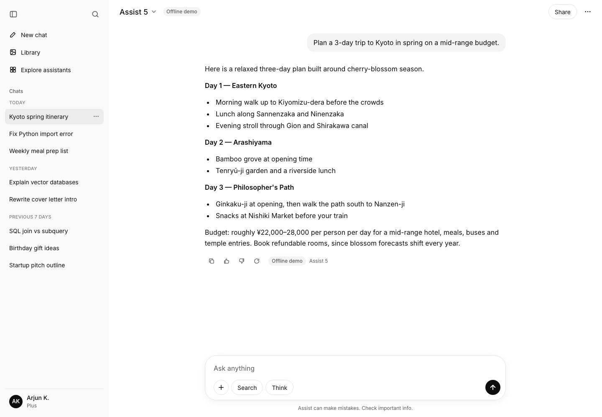
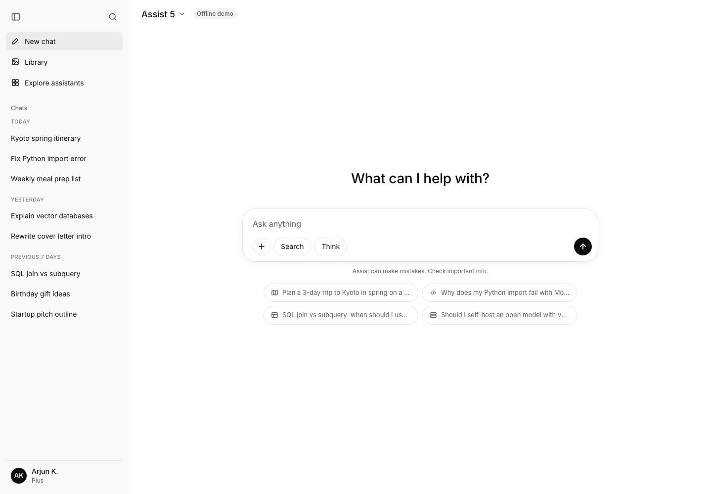
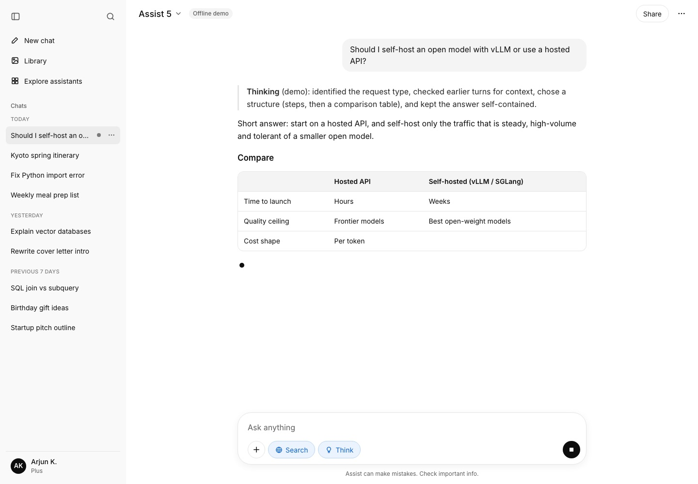
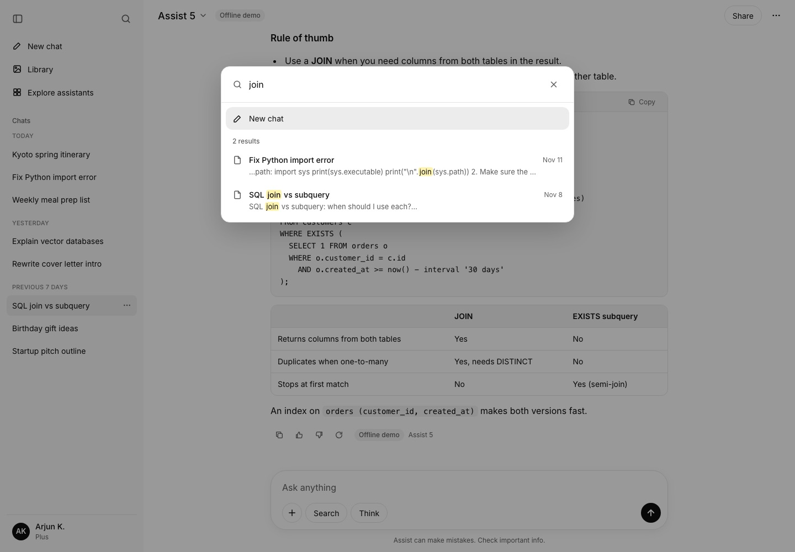
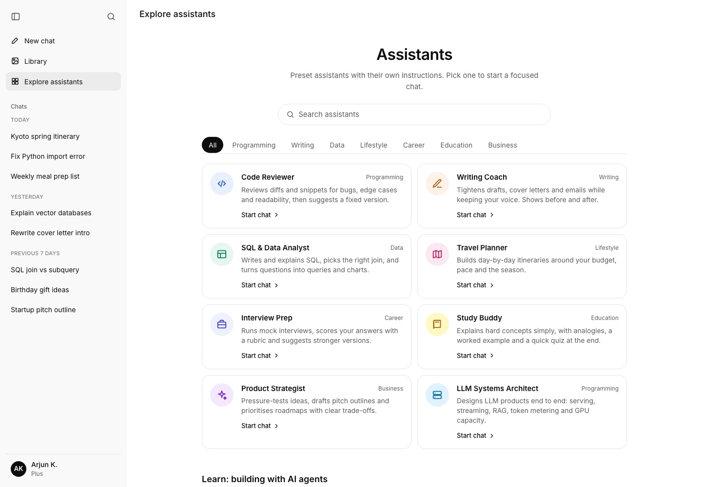
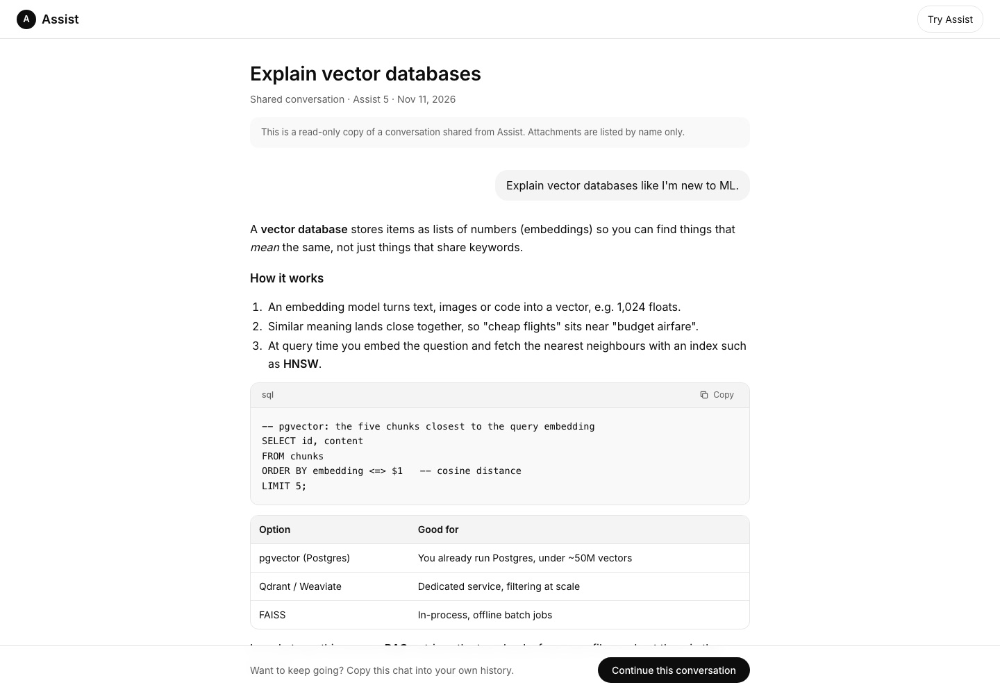
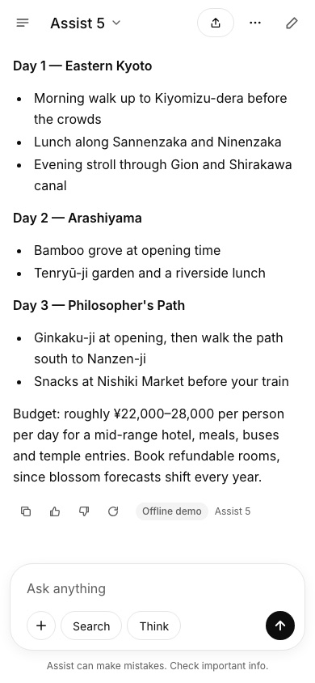

<div align="center">

# Assist: a ChatGPT clone built with Next.js and Claude Code

**Designed with Claude, coded and tested with Claude Code, and planned for millions of users with Claude Opus 5.5: how I built Assist, a working ChatGPT-style app.**

[](LICENSE)


[](https://claude.com/product/claude-code)

[**Read the full build & scale guide**](https://suhasbhairav.com/saas-clones/chatgpt-clone) · [Screenshots](#screenshots) · [Getting started](#getting-started) · [Scaling](#scaling-to-millions-of-users)

</div>



Assist is a working ChatGPT-style clone built with Next.js 16: real token streaming from the Anthropic API (with an offline demo mode), conversations, file context, sharing and preset assistants. The guide shows how to scale it to millions of users with vLLM GPU serving on Hetzner, token metering and resumable streams.

This repository is the source code for the guide **[How I Built a ChatGPT Clone Using Claude Code: Assist](https://suhasbhairav.com/saas-clones/chatgpt-clone)** on suhasbhairav.com. The guide covers the production data model, API design, capacity math, Hetzner server plans for every growth stage, real-time notifications, security and monthly costs.

## Contents

- [Screenshots](#screenshots)
- [Features](#features)
- [Built with Claude](#built-with-claude)
- [Tech stack](#tech-stack)
- [Getting started](#getting-started)
- [Pages](#pages)
- [Project structure](#project-structure)
- [API](#api)
- [What is real and what is simulated](#what-is-real-and-what-is-simulated)
- [Scaling to millions of users](#scaling-to-millions-of-users)
- [Deploying](#deploying)
- [Contributing](#contributing)
- [License](#license)
- [Disclaimer](#disclaimer)

## Screenshots


*A conversation at /c/kyoto-spring-itinerary: date-grouped history, model picker, Share, and copy / thumbs / regenerate actions under the reply.*



*New chat: the composer with + attach, Search and Think toggles. Sending creates a conversation and navigates to /c/<id> while streaming.*



*Mid-stream: partial markdown (including a half-built table) renders live, the send button becomes Stop, and the sidebar shows a generating indicator.*



*Search chats (sidebar icon or Cmd/Ctrl+K) searches titles and message text with highlighted snippets. URL-addressable via ?search=.*



*Explore assistants: presets fetched from /api/assistants. System prompts stay on the server and are looked up by id when a chat starts.*



*A shared link (/share/<id>) served from the share API: read-only markdown, code blocks with copy, and Continue this conversation.*

<p align="center"></p>

<p align="center"><em>Mobile layout at 390×844: sidebar becomes a drawer, Share collapses to an icon, and message actions are always visible for touch.</em></p>

## Features

- **Streaming chat**: `POST /api/chat` returns Server-Sent Events (`meta`, `delta`, `notice`, `done`, `error`). On the server it reads the Anthropic stream (`stream: true`, `anthropic-version: 2023-06-01`) and re-emits text deltas. Stop generating aborts the fetch, and the abort reaches the upstream request.
- **Models**: "Assist 5" maps to `claude-sonnet-5-5` and "Assist 5 mini" maps to `claude-haiku-5-5`. You pick the model in the header dropdown or in Settings.
- **Think and Search toggles**: Think adds a more detailed system prompt and raises `max_tokens`. With a key set, Search turns on the web search tool; if the key does not support it, the request is retried without the tool and the user sees a notice. In demo mode, Search only adds a labelled note to the reply.
- **Conversations**: start a new chat, see chats grouped as Pinned, Today, Yesterday, Previous 7 days and so on, rename (inline or from a dialog), delete (with confirmation) and pin. Titles are set automatically from the first message by `/api/title`, which uses Haiku when a key is set and a heuristic otherwise. Each chat has its own route, `/c/[id]`. Everything persists in `localStorage`.
- **Search chats**: open it with the sidebar search icon or Cmd/Ctrl+K. It matches titles and message text, highlights the match, and supports keyboard navigation. It is also URL-addressable: `?search=join`.
- **Composer**: the textarea grows as you type. Enter sends and Shift+Enter adds a new line. You can attach text or code files with **+**, drag and drop, or paste. Files are read in the browser (up to 5 files, 200 KB each, binary files rejected), shown as chips, and sent as `<file name="...">` context blocks.
- **Messages**: the markdown renderer is dependency-free and outputs React elements, never raw HTML. It handles headings, nested lists, task lists, tables, blockquotes and fenced code blocks with a copy button, and it copes with unclosed fences while a reply is still streaming. Each message has copy, thumbs up/down (saved), regenerate, and edit-and-resend for user messages. Token usage is shown per reply.
- **Share**: `POST /api/share` saves a snapshot in server memory and also keeps a copy in localStorage, then copies `/share/<id>` to the clipboard. The share page is read-only and offers "Continue this conversation".
- **Library** (`/library`): every file you have attached, plus direct uploads. You can preview a file, use "Ask about it" to start a new chat with it attached, or delete it.
- **Explore assistants** (`/explore`): eight preset assistants with categories and search. Picking one starts a chat with that assistant's system prompt, which stays on the server and is looked up by id. The page also has a short video row from The Bhairav Show.
- **Layout and settings**: the sidebar collapses to an icon rail (Cmd/Ctrl+Shift+S). Phone-width screens get a slide-in drawer. The account menu opens a Settings modal with light/dark/system theme, default model, response source, restore demo chats, clear all chats, and a list of keyboard shortcuts. Settings is URL-addressable: `?settings=data`.

## Built with Claude

Assist was designed with Claude on a design canvas, coded and tested with [Claude Code](https://claude.com/product/claude-code), and its path to millions of users was analysed with [Claude Opus 5.5](https://www.anthropic.com/claude/opus). A Claude Code [sub-agent](https://code.claude.com/docs/en/sub-agents) built this app in about 26 minutes, in parallel with five other clones.

| Stage | Claude tool | What it did |
|---|---|---|
| Design | [Claude design canvas](https://claude.com/product/overview) | The app screens were designed with Claude on a design canvas, one board per product. |
| Coding | [Claude Code](https://claude.com/product/claude-code) | A Claude Code sub-agent wrote Assist: 39 files, 5 pages, 6 API routes, in about 26 minutes. |
| In-app AI | [Claude API (Messages API)](https://platform.claude.com/docs/en/api/messages) | Assist streams real answers from Claude Sonnet 5.5 and Claude Haiku 5.5 when an API key is set. |
| Parallel agents | [Claude Code sub-agents](https://code.claude.com/docs/en/sub-agents) | Six clones were built at the same time, one sub-agent per app. |
| Testing & screenshots | [Claude Code](https://claude.com/product/claude-code) | Build, lint, a running server and 7 screenshots that Claude reviewed and fixed. |
| Scalability & infrastructure analysis | [Claude Opus 5.5](https://www.anthropic.com/claude/opus) | Capacity math, Hetzner server plans, real-time design, security and cost models. |

Want to try the same workflow? Start with the [Claude Code overview](https://code.claude.com/docs/en/overview).

## Tech stack

- Next.js 16 (App Router, Cache Components)
- React 19
- Tailwind CSS v4
- Route Handlers with ReadableStream (SSE)
- Anthropic Messages API (claude-sonnet-5-5, claude-haiku-5-5)
- next/font (Inter)
- localStorage persistence
- Production: PostgreSQL 17 + pgvector, Valkey, NATS JetStream, vLLM / SGLang on Hetzner GEX, Cloudflare

## Getting started

**Prerequisites:** Node.js 20.9.0 or newer (required by Next.js 16) and npm.

```bash
git clone https://github.com/suhasbhairav/chatgpt-clone.git
cd chatgpt-clone
npm install
npm run dev
```

Open [http://localhost:3000](http://localhost:3000).

For a production build:

```bash
npm run build
npm start
```

### Environment variables

Copy `.env.example` to `.env.local` and fill in what you need. Everything is optional; the app works without any keys.

```bash
cp .env.example .env.local
```

```bash
# Optional. When set, /api/chat streams real answers from the Anthropic Messages API.
# When empty, Assist uses its built-in offline demo responder (clearly labelled in the UI).
# Never commit a real key. Put it in .env.local (git-ignored).
ANTHROPIC_API_KEY=
```

### Scripts

| Command | What it does |
|---|---|
| `npm run dev` | Start the development server |
| `npm run build` | Create a production build |
| `npm start` | Serve the production build |
| `npm run lint` | Run ESLint |

## Pages

- `/(app)`
- `/(app)/c/[id]`
- `/(app)/explore`
- `/(app)/library`
- `/share/[id]`

## Project structure

```
app/
  layout.js                 Inter font, metadata, pre-paint theme script
  (app)/layout.js           Suspense + AppShell (sidebar, dialogs, provider)
  (app)/page.js             New chat (home)
  (app)/c/[id]/page.js      Conversation
  (app)/library/page.js     Library
  (app)/explore/page.js     Explore assistants
  share/[id]/page.js        Read-only shared chat
  api/chat/route.js         Streaming chat (Anthropic or offline demo)
  api/title/route.js        Auto-title
  api/share/route.js        Create share      api/share/[id]/route.js  Read share
  api/status/route.js       live | demo       api/assistants/route.js  Gallery data
components/
  AppProvider.js            State, persistence, streaming client, actions
  AppShell.js Sidebar.js ChatHeader.js ChatView.js HomeView.js Composer.js
  Message.js Markdown.js Dialogs.js LibraryView.js ExploreView.js ShareView.js ui.js Icons.js
lib/
  assistants.js             Presets + model mapping
  demo.js                   Offline demo responder + heuristic titles
  seed.js storage.js utils.js
  server/anthropic.js       Minimal Messages API client + SSE parser
  server/rateLimit.js       In-memory fixed-window limiter
  server/shareStore.js      In-memory share store (globalThis Map)
data/channel-videos.json    Video metadata for the Explore page
```

## API

| Method | Route | Body / result |
| --- | --- | --- |
| POST | `/api/chat` | `{ model, messages[{role,content}], think, search, assistantId }` → SSE stream. 30 req/min per IP. |
| POST | `/api/title` | `{ text }` → `{ title, source }` |
| POST | `/api/share` | `{ title, model, messages }` → `201 { id, url }` |
| GET | `/api/share/:id` | Shared snapshot, or 404 |
| GET | `/api/status` | `{ mode: "live" \| "demo", models }` |
| GET | `/api/assistants` | Public preset data (no system prompts) |

## What is real and what is simulated

- **Server state is in memory.** Shares and rate-limit counters live in module/global memory and are lost when the server restarts. The share page falls back to the sharer's localStorage copy.
- **Chats and files are stored only in the browser.** There are no accounts, and "Arjun K. / Plus" is a static demo profile.
- **Demo mode does not browse or reason.** Without an API key, answers are canned or built by simple heuristics on the topic and any attached files.

## Scaling to millions of users

This repo is a working demo. Taking it to production means replacing in-memory state and browser storage with real services. Short version:

1. Add auth (OIDC or passkeys) and move chats, messages and files to PostgreSQL. Add pgvector for retrieval over uploaded files, and keep blobs in S3-compatible object storage.
2. Put the chat route behind a gateway that meters tokens per user, enforces quotas with Valkey/Redis, and writes usage events to a queue for billing.
3. Make streams resumable: persist deltas to Redis Streams keyed by message id and resume with `Last-Event-ID`. Sync conversations across devices over a WebSocket/SSE channel.
4. Add moderation, prompt-injection guards for file content, a CSP and audit logging. Add OpenTelemetry traces for time-to-first-token and tokens/s.
5. Choose hosted APIs or self-hosted vLLM/SGLang on GPU servers per workload. See the write-up at https://suhasbhairav.com/saas-clones/chatgpt-clone.

The full plan is in the guide. It covers the PostgreSQL schema, cursor-paginated APIs, Valkey caching, a message queue, object storage plus CDN, a real-time gateway, security and observability, with server choices for each stage:

| Stage | Users | Estimated Hetzner cost / month |
|---|---|---|
| Launch | 0–50K MAU | €211 |
| Growth | ~500K MAU | €2,930 |
| Scale | ~5M MAU | €27,749 |
| Hyperscale | 10M+ MAU | €88,323 |

Prices are estimates in EUR excl. VAT from hetzner.com (November 2026); verify before ordering. **[Read the full guide →](https://suhasbhairav.com/saas-clones/chatgpt-clone)**

## Deploying

- **Vercel or any Node host:** `npm run build && npm start`. Note that API routes keep demo state in memory, so it resets on restart and isn't shared between instances.
- **Your own server (for example Hetzner):** run `npm ci && npm run build`, start it with `npm start` behind a reverse proxy such as Caddy or Nginx, and keep it alive with systemd, PM2 or Docker.

## Contributing

Issues and pull requests are welcome. Please run `npm run lint` and `npm run build` before opening a PR.

## License

Released under the [MIT License](LICENSE). Copyright (c) 2026 Suhas Bhairav.

**Third-party content:**
- Fonts are loaded through `next/font` from Google Fonts under their own licenses.

## Disclaimer

Assist is an independent educational project with its own name and branding. It is not affiliated with, endorsed by or sponsored by ChatGPT or OpenAI. "ChatGPT" is a trademark of its owner and is used here only to describe the kind of product this demo recreates.

---

Built by [Suhas Bhairav](https://suhasbhairav.com) · [Guide](https://suhasbhairav.com/saas-clones/chatgpt-clone) · [All SaaS clones](https://suhasbhairav.com/saas-clones) · [YouTube](https://www.youtube.com/@suhasbhairav)
